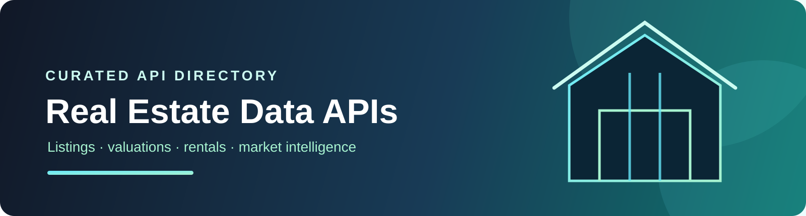
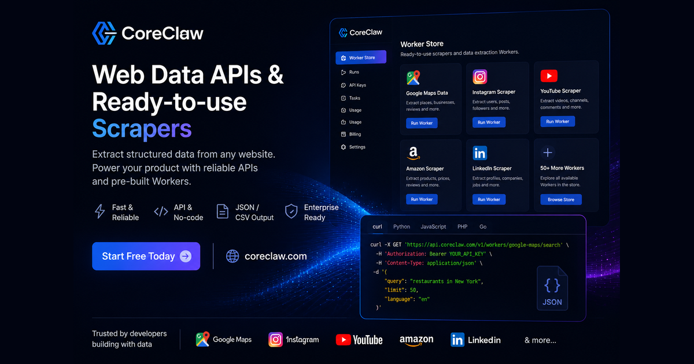

<div align="center">



<br />

# 🏠 Real Estate Data APIs

**Property listings, valuations, rental intelligence, agent research, and market data APIs.**

[](https://github.com/cporter202/real-estate-data-apis/stargazers)
[](https://github.com/cporter202/real-estate-data-apis/actions/workflows/daily-sync.yml)
[](LICENSE)

<p>
  <a href="#featured-provider-paths"><strong>Featured Providers</strong></a> ·
  <a href="catalog/README.md"><strong>Browse 1,089 Apify APIs</strong></a> ·
  <a href="featured/coreclaw.md"><strong>Browse CoreClaw Workers</strong></a> ·
  <a href="#start-with-a-job-to-be-done"><strong>Start Building</strong></a>
</p>

</div>

## What this repo is

A focused directory of APIs and web-data workers for building real-estate software, investment research tools, rental dashboards, property alerts, and market-intelligence workflows.

The API lists are the main content of this repository:

- [Browse Apify real-estate APIs](catalog/README.md) — a large directory of ready-to-use actors.
- [Browse CoreClaw real-estate workers](featured/coreclaw.md) — focused workers with API and MCP access.

| API list | What you will find |
|---|---|
| [Apify API list](catalog/README.md) | The full real-estate API directory, with one entry per actor and description. |
| [CoreClaw API list](featured/coreclaw.md) | The full real-estate worker directory, with worker IDs and capabilities. |

## Featured provider paths

<table>
  <tr>
    <td width="50%" valign="top">
      <h3>🔎 Apify actor catalog</h3>
      <p>Large, searchable coverage for property listings, agents, locations, rentals, and market research.</p>
      <p><a href="https://apify.com/?fpr=p2hrc6"><strong>Explore Apify with my referral →</strong></a></p>
    </td>
    <td width="50%" valign="top">
      <a href="https://www.coreclaw.com/store/categories?fpr=chris69"></a>
      <h3>⚡ CoreClaw worker catalog</h3>
      <p>Focused web-data workers with API and MCP access for practical real-estate extraction.</p>
      <p><a href="https://www.coreclaw.com/store/categories?fpr=chris69"><strong>Explore CoreClaw with my referral →</strong></a></p>
    </td>
  </tr>
</table>

| Coverage snapshot | Current directory |
|---|---:|
| Apify real-estate actors | **1,089** |
| CoreClaw real-estate workers | **1** |
| Sync cadence | **Daily** |

## Start with a job to be done

| If you need to… | Start here |
|---|---|
| Search listings or collect property details | [Apify catalog](catalog/README.md) |
| Find Zillow property data quickly | [CoreClaw workers](featured/coreclaw.md) |
| Build a rental or sales monitoring dashboard | [Rental monitoring playbook](playbooks/rental-monitoring.md) |
| Research investor or FSBO opportunities | [Investor research playbook](playbooks/investor-research.md) |
| Compare providers before building | [Provider selection checklist](playbooks/provider-selection.md) |

## Common build paths

- Property-search and listing aggregation
- Rental-price and availability monitoring
- FSBO, investor, and agent lead research
- Comparable-property and valuation dashboards
- Neighborhood, map, and location intelligence
- Market reports and recurring data products

## Audience

Real-estate apps, agents and brokers, investors, market researchers, and PropTech builders.

## Provider notes

This repository preserves referral parameters present in the API lists where available. See [LINKS.md](LINKS.md) for a neutral referral-link note. A referral link is not an endorsement of fit, quality, legality, or pricing.

Use public data responsibly. Review provider documentation, platform terms, privacy obligations, rate limits, and applicable real-estate regulations before launching a production workflow.

## Maintenance

GitHub Actions checks the upstream Apify and CoreClaw category directories daily and updates only the catalog files when their content changes. The sync can also be run locally:

```bash
node settings/sync_catalog.js
```

The source URLs and update behavior are documented in [settings/repo.config.json](settings/repo.config.json).

## Related directories

- [API Mega List](https://github.com/cporter202/API-mega-list)
- [Ecommerce Intelligence APIs](https://github.com/cporter202/ecommerce-intelligence-apis)
- [Job Data APIs and Scrapers](https://github.com/cporter202/job-data-apis-and-scrapers)
